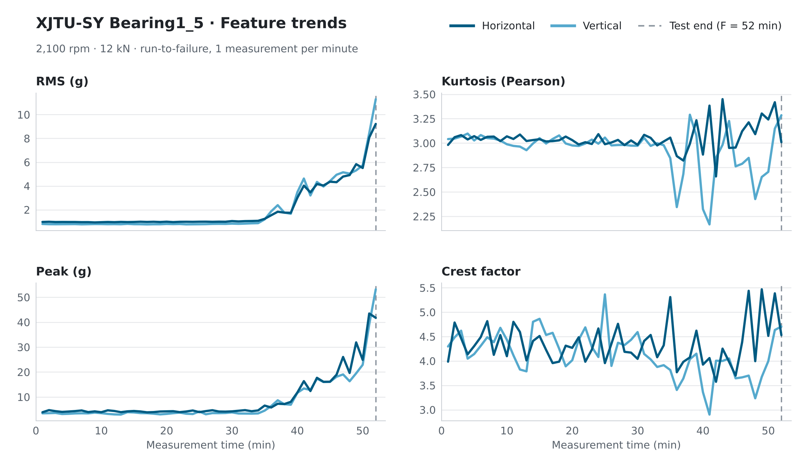
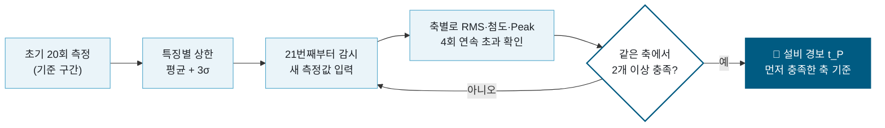
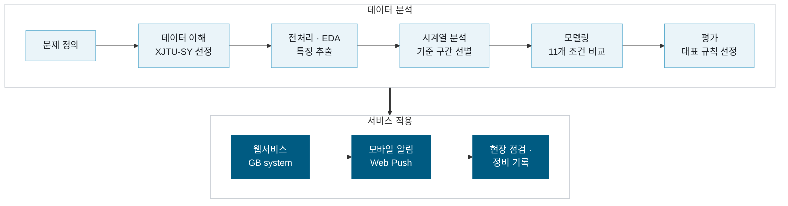
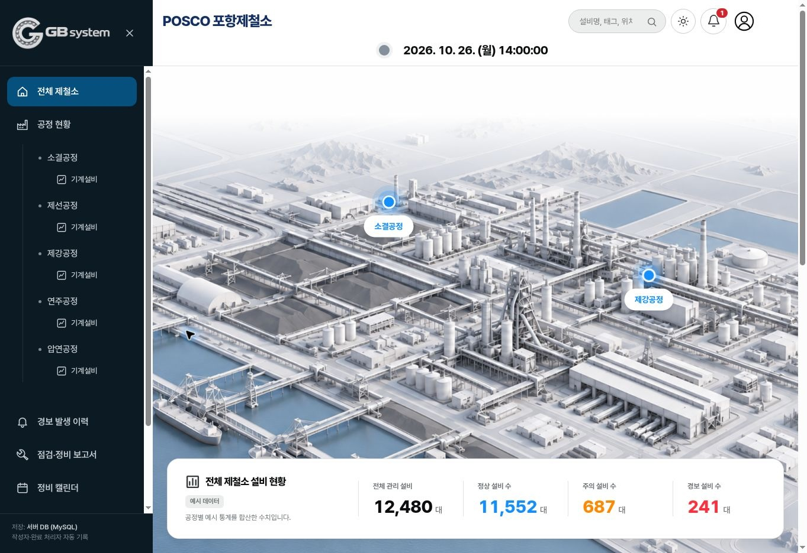
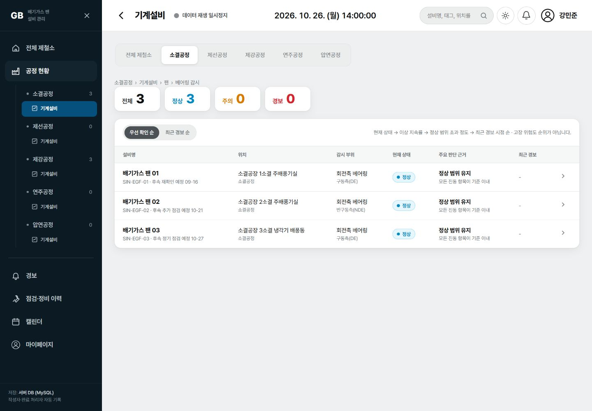
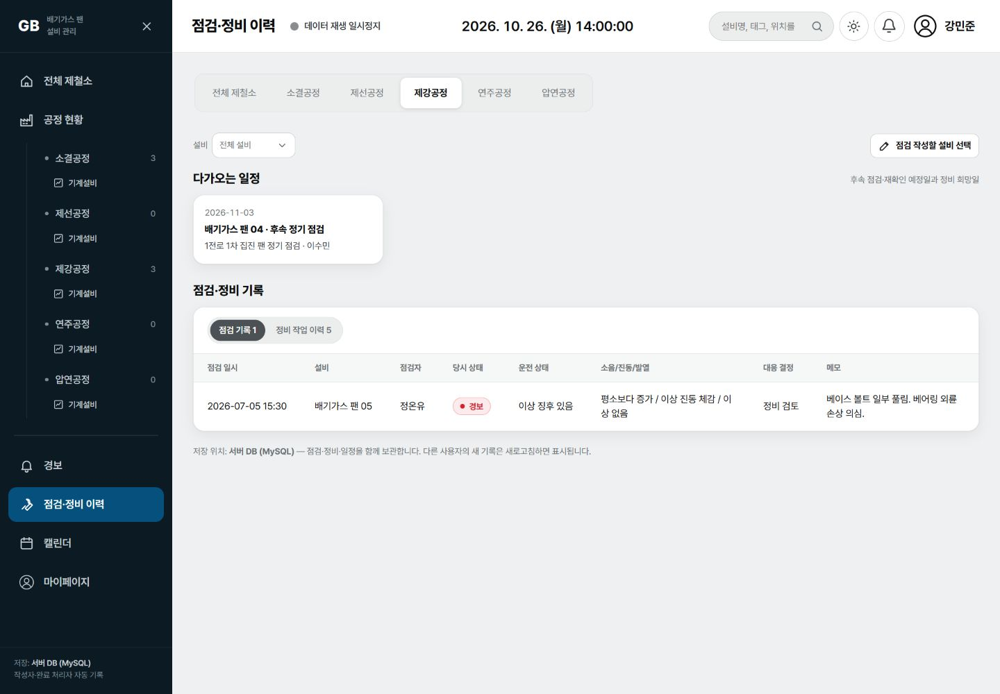
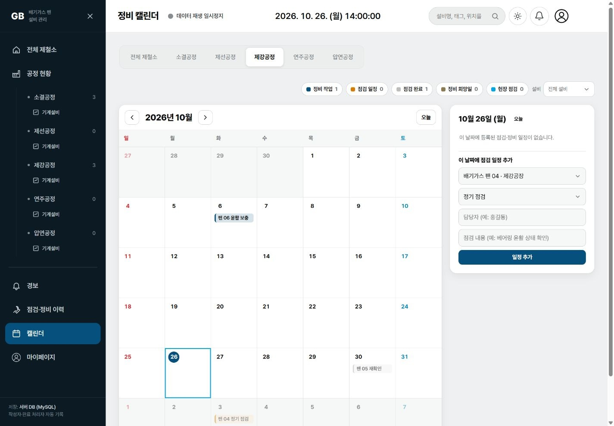
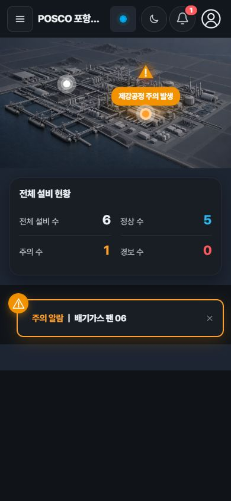
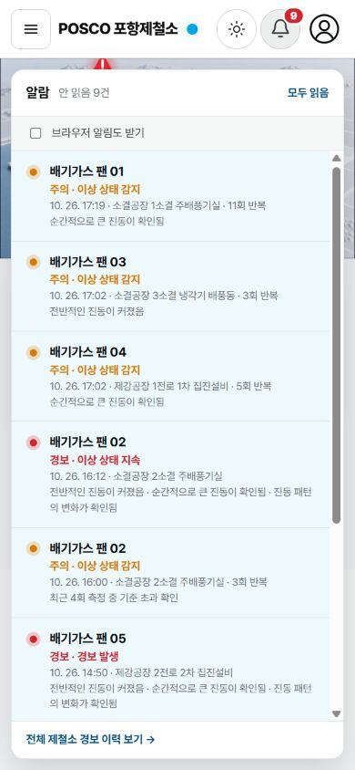

<div align="center">

# 🧸 GummyBearing

### 대형 회전기 베어링 열화 추적과 교체 시점 판단

포스코 K-뉴딜 아카데미 「설비 고장을 예측하는 AI 데이터 분석」 통합 프로젝트
<br>


<br>


 
<br>

[프로젝트 소개](#-1-프로젝트-소개) · [핵심 결과](#-2-핵심-결과--대표-운영-규칙) · [진행 흐름](#-3-프로젝트-진행-흐름) · [웹 서비스](#-6-웹-서비스-프로토타입) · [최종 산출물](#-9-최종-산출물)

</div>
<br>

## 1. 프로젝트 소개

> 베어링 진동 데이터에서 **초기 정상 구간 대비 이탈**을 추적해 경보 시점(P)을 정하고,
> **어떤 특징·축에서 몇 회 초과했는지**를 근거로 점검 및 교체 검토 시점을 제시합니다.

**분석 데이터: XJTU-SY Bearing Dataset**

* 정상 상태부터 고장까지 진행한 베어링 가속 수명 시험 데이터
* 베어링별 수평·수직 진동 신호에서 RMS·첨도·Peak 특징을 추출해 운영 규칙 비교와 선정에 사용

<div align="center">
  
  <br>
  <sub>정상 구간에서 고장 직전까지 진동 특징이 변하는 모습 (XJTU-SY Bearing1_5)</sub>
</div>

<br>

## 2. 핵심 결과 — 대표 운영 규칙

<div align="center">

### N=20 · 연속 4회 · 고정 복합 B 방식 2/3

</div>



1. 초기 20회 측정으로 특징별 상한(평균 + 3σ)을 정합니다.
2. 같은 축의 RMS·첨도·Peak 중 **2개 이상**이 각각 상한을 **4회 연속** 초과하면 그 시점을 P로 잡습니다.
3. 수평·수직 중 어느 한 축에서 성립하면 설비 경보로 봅니다.


N20·K4 조건에서 초기 구간 검증을 통과한 XJTU-SY 베어링 6개를 비교한 결과입니다.

| 방법 | 미경보 | 최소 선행시간 | 최저 이상 지속률 |
| --- | :---: | :---: | :---: |
| 고정 RMS | 0/6 | 19분 | 48.26% |
| 고정 B 1/3 | 0/6 | 19분 | 52.00% |
| ⭐ **고정 B 2/3 (대표)** | **0/6** | **14분** | **78.63%** |
| 고정 B 3/3 | 2/6 | 미산출 | 미산출 |
| 원본 마할라노비스 | 0/6 | 17분 | 84.08% |
| 증가분 마할라노비스 | 0/6 | 17분 | 41.57% |
| Isolation Forest 직접 3σ | 0/6 | 14분 | 23.42% |

> [!NOTE]
> * 방법마다 이상 기준이 달라 이 표는 기술통계 비교이며 정확도 순위가 아닙니다.
> * 선행시간은 `실험 종료 − P`이며 실제 남은 수명이나 고장 예측 시간이 아닙니다.
> * 원본 마할라노비스는 두 수치가 더 높지만 감소 방향·특징 조합 변화까지 포함하므로 비교군으로 남겼습니다.
> * B 2/3은 최적 모델의 입증이 아니라, 여러 특징의 반복 초과를 현장 판단 근거로 설명할 수 있다는 운영 목적에 맞춘 선택입니다.

결과 파일과 지표 정의는 아래 [분석 결과 상세](#분석-결과-상세)를 참고해주세요.

### 분석 결과 상세

<details>
<summary><b>펼쳐서 보기</b> — 생성 파일 · 결과 CSV · CSV 해석 · 주요 지표 · IF 설정 · 계산상 주의</summary>

`05_xjtu_final_model_comparison` 노트북의 결과 파일과 읽는 법입니다.

#### 생성 파일

| 위치 | 내용 |
| --- | --- |
| `results/xjtu_operating_rule/` | 결과 CSV 10개 |
| `figures/xjtu_operating_rule/` | 결과 PNG 12개 |
| `tests/test_xjtu_final_model_comparison.py` | 경보 정의와 실제 데이터 회귀검증 |

#### 결과 CSV 1~10

| 파일 | 내용 |
| --- | --- |
| `01_baseline_validation` | 초기 N=5~50, 수평·수직 RMS와 첨도의 MK 검증. 15개 전체와 자료 부족 표시 |
| `02_rms_cumulative_consecutive` | N20 통과 집단에서 고정 RMS K=1~8 누적·연속 비교 |
| `03_fixed_single_composite` | N20·K4 고정 RMS 및 B 1/3·2/3·3/3 |
| `04_moving_single_composite` | N20·K4 이동 RMS 및 B 1/3·2/3·3/3 |
| `05_fixed_vs_mahalanobis` | N20·K4 고정 RMS·복합과 원본 마할라노비스 |
| `06_isolation_forest_thresholds` | N15 통과 8개·N20 통과 6개에서 IF 자동·직접 3σ 판정 K=1~8 (각각 16·21번째부터 감시, 초기 학습 구간 자동 이상 비율 포함) |
| `07_overall_direct_comparison` | N20·K4 고정 RMS·복합, 원본 MD, 직접 3σ IF |
| `08_common_N15_N20` | N15·N20 공통 통과 집단. 감시 시작은 모두 21번째, N20−N15 차이 포함 |
| `09_md_direction_comparison` | N20·K4 원본 MD, 증가분 MD, 고정 B 2/3 세 조건 비교 |
| `10_representative_operating_rule` | 전체 방법 비교와 대표 운영 규칙 한 행·선택 근거 (최적 모델 순위나 절충 점수 없음) |

#### CSV 해석

| row_type | 의미 |
| --- | --- |
| `summary` | 방법별 집계 |
| `bearing` | 베어링별 결과 (01번은 베어링별 baseline 검증) |
| `calibration` | 06번 IF 상한·초기 자동 판정 진단 |
| `paired_delta` | 08번 동일 베어링의 N20−N15 차이 |
| `direction_delta` | 09번 원본 MD와 증가분 MD의 병렬 결과 |
| `operating_rule` | 10번 대표 운영 규칙 (`optimality_claim=False`) |
| `selection_reason` | 10번 선택 이유와 한계 (`reason_no`, `reason_text`) |

* 행 종류에 해당하지 않는 열은 빈값입니다. 빈값을 0이나 정상으로 해석하면 안 됩니다.
* 여러 파일의 집계·개별 행을 합산하면 중복 집계되므로 필요한 `row_type`부터 골라 사용합니다.

#### 주요 지표

| 지표 | 의미 |
| --- | --- |
| `t_P` | 1부터 세는 K번째 경보 확인 완료 측정번호 (MK p-value와 다름) |
| `t_P_elapsed_min` | 첫 관측부터 P까지 경과 분 (측정번호 1 = 0분) |
| `lead_time_min` | 마지막 관측과 P의 시간 차이. 실제 고장 예측 시간이 아님 |
| `persistence_pct` | P를 포함해 종료까지 이상 조건이 성립한 비율. IF 외 방법은 H 또는 V의 OR, IF는 6개 특징 통합 점수 기준 |
| `abnormal_observations` | 지속률의 분자 (`post_P_observations`는 P를 포함한 분모) |
| `first_alarm_axis` | 최초 확정 경보축 H, V, H+V (통합 IF는 `not_applicable`) |
| `first_axis_persistence_pct` | 최초 경보축의 P 이후 이상 비율. H+V 동시 경보면 두 축 평균이며 OR 지속률과 다름 |
| `no_alarm_count` | 확정 경보가 없는 수. 비교 집단에서 제외하지 않음 |
| `min_lead_time_min`, `min_persistence_pct` | 전원 경보 시 전체 집단 최저값. 두 값은 서로 다른 베어링에서 나올 수 있음 |
| `conditional_*` | 경보가 난 베어링에 한정한 통계. 미경보가 있는 방법을 전원 경보 방법보다 좋다고 평가하는 데 쓰면 안 됨 |

IF는 최초 경보축·축별 P·축별 지속률을 산출하지 않고 빈값으로 둡니다.

#### Isolation Forest 설정

* 입력: 수평·수직 RMS·첨도·Peak 6개 특징을 베어링별 한 모델에 입력
* 표준화: 각 N개 baseline의 특징 평균·표본 표준편차(ddof=1)
* `n_estimators=100`, `max_samples=N`, `contamination='auto'`, `random_state=42`, `n_jobs=1`
* 이상 점수 `-score_samples`, 직접 상한은 baseline 점수 평균 + 3×점수 SD(ddof=1)
* 직접 판정은 상한 초과(`>`), 자동 판정은 `predict == -1`이며 두 방식 모두 연속 K번째를 P로 정의
* N20·K4 직접 IF: 6/6 경보, 최소 선행시간 14분, 최저 이상 지속률 23.42%
* N15·K4 직접 IF: 7/8 경보. 조건부 최소 선행시간 14분, 조건부 최저 이상 지속률 21.43% (전원 대상 최소값은 미산출)

#### 계산상 주의

* B 방식의 한 표는 같은 축에서 동일 특징이 4회 연속 초과해야 성립합니다. 수평 RMS와 수직 Peak를 합쳐 2/3으로 세지 않습니다.
* 최초 P와 경보 지속 표시는 별개이며, 지속률은 횟수 조건 전의 현재 이상 여부로 계산합니다.
* 증가분 MD의 증가분은 초기 평균 대비 양의 편차이며 전 시점 대비 차분이 아닙니다.
* 대표 조건과 전체 모델 비교는 N20 통과 6개에 한정합니다. 06번 IF의 N15는 독립 통과 8개이며, 08번만 공통 통과 6개와 동일 감시 시작(21번째)을 사용합니다.
* MK 검증 통과가 초기 정상 상태를 증명하지는 않습니다.

</details>

<br>

## 3. 프로젝트 진행 흐름



### 데이터 분석

| Notebook | 내용 |
| --- | --- |
| `00_check_missing_value` | 결측치 확인 |
| `01_ims_preprocessing` | IMS 전처리 |
| `02_cwru_preprocessing` | CWRU 전처리 |
| `03_xjtu_sy_preprocessing` | XJTU-SY 전처리 및 특징 추출 |
| `04_xjtu_sy_eda` | XJTU-SY 분포·시계열·특징 관계 EDA |
| `05_xjtu_final_model_comparison` | 운영 규칙·모델 비교 및 대표 규칙 선정 |

### 서비스 적용 · GB system

분석에서 선정한 대표 경보 규칙(N=20, 고정 복합 B 2/3, 연속 4회)을 가상 배기가스 팬 6대에 연결해, 상태 확인부터 현장 점검·정비 기록까지 이어지는 웹서비스로 구현했습니다.

| 구분 | 내용 |
| --- | --- |
| 상태 확인 | 공정별 정상·주의·경보 현황, 설비 목록, 설비별 RMS·Peak·첨도 그래프와 경보 근거 |
| 경보 판정 | XJTU-SY 특징 CSV를 실시간처럼 재생하며 브라우저에서 대표 규칙으로 판정 |
| 모바일 알림 | 최초 경보와 승인 요청을 Web Push(PWA)·이메일로 전달, 같은 경보는 한 번만 발송 |
| 점검·정비 | 현장 점검 보고서 작성 → 설비 팀장 승인 → 정비 캘린더·이력 관리 |
| 구성 | AWS EC2 · Docker Compose · Caddy(HTTPS) · Python 웹서버 · MySQL 8.4 |

> 서비스의 설비 정보와 초기 점검 기록은 시나리오용 예시이며, 진동 데이터만 실제 XJTU-SY 실험 자료입니다.
<br>

## 4. 개발 환경 및 실행

| 구분 | 사용 도구 |
| --- | --- |
| 언어·환경 | Python 3.14 · Conda · Jupyter Notebook · VS Code |
| 분석 | pandas · NumPy · SciPy · scikit-learn · Matplotlib |
| 웹 서비스 | Python 서버 · MySQL · Docker Compose · AWS EC2 |
| 협업 | GitHub Organization |

**가상환경 생성 및 활성화**

```bash
conda env create -f environment.yml
conda activate GummyBearing
```

VS Code에서 Python 인터프리터와 Jupyter 커널을 `GummyBearing`으로 선택합니다.

<br>

## 5. 프로젝트 구조

```text
GummyBearing/
├── README.md
├── Contributing.md
├── environment.yml
├── .gitignore · .gitattributes
├── DATA/                       # 원본·특징 데이터 (Git 제외)
├── notebooks/                  # 분석 Notebook 00~05
├── src/                        # 전처리·특징 추출 함수 (IMS·CWRU·XJTU-SY 공통)
├── results/
│   ├── eda/                    # 개체·특징별 기술통계 (XJTU_SY_stats.csv)
│   └── xjtu_operating_rule/    # 모델 비교 결과 CSV 01~10
├── figures/
│   ├── eda/                    # 분포·시계열·특징 관계 그래프
│   └── xjtu_operating_rule/    # 기준 구간·모델 비교 그래프
├── app/
│   └── gb-system/              # GB system 웹서비스 (Python 서버·웹앱·MySQL·Docker)
├── demos/                      # 대시보드·ERP 연계 HTML 데모
├── docs/
│   └── final-pr/               # 최종 PR 설명·배포 검증 기록
├── tools/                      # 최종 PR 준비·검증 스크립트
├── tests/                      # 모델 비교 결과 검증 테스트
└── reports/                    # 문제정의서 · 결과보고서 · 발표자료
```

원본 데이터는 각자 로컬 `DATA/` 폴더에 저장하며 GitHub에 업로드하지 않습니다.

<br>

## 6. 웹 서비스 프로토타입

대표 운영 규칙을 적용한 **배기가스 팬 설비 관리 웹 서비스**입니다.
"어떤 팬을 먼저, 왜 확인해야 하는지"를 보여주고 현장 점검부터 정비 이력까지 한 흐름으로 관리합니다.

<table>
  <tr>
    <td align="center" colspan="2">
      <br>
      <sub><b>메인 화면</b> · 제철소 배치도와 공정별 정상·주의·경보 현황</sub>
    </td>
  </tr>
  <tr>
    <td align="center" width="50%">
      <br>
      <sub><b>공정별 기계설비 현황</b> · 상태와 판단 근거를 한눈에</sub>
    </td>
    <td align="center" width="50%">
      <br>
      <sub><b>점검·정비 이력</b> · 다가오는 일정과 기록 통합</sub>
    </td>
  </tr>
  <tr>
    <td align="center" width="50%">
      <br>
      <sub><b>정비 캘린더</b> · 공정별 일정 확인과 추가</sub>
    </td>
    <td align="center" width="50%">
      
      <br>
      <sub><b>모바일 화면</b> · 주의·경보 푸시 알림과 메뉴</sub>
    </td>
  </tr>
</table>

**주요 기능**

* 🗺️ 제철소·공정 배치도 위 설비 상태(정상·주의·경보)와 실시간 경보 알림
* 📈 설비별 진동 그래프와 판단 근거(초과한 특징·축·횟수)
* 📝 점검·정비 기록, 캘린더, 이력 관리, 로그인·마이페이지
* ☁️ Python 서버 + MySQL, Docker Compose 기반 AWS EC2 배포

> [!NOTE]
> 진동 데이터는 XJTU-SY 실측값을 가상의 팬 6대에 대입한 시연용이며,
> 설비 사양과 점검·정비 이력은 화면 구성을 위한 가상값입니다.

<br>

## 7. 팀원


<div align="center">

|  | |   |
| :---: | :---: | :---: |
| **김수민** | **강민준** | **정온유** |

</div>
<br>

## 8. 협업 규칙

브랜치, 커밋, PR 및 파일 관리 규칙은 [Contributing.md](Contributing.md)를 참고해주세요.

<br>

## 9. 최종 산출물

| 산출물 | 위치 |
| --- | --- |
| 📄 문제정의서 | [reports/문제정의서.pdf](reports/문제정의서.pdf) |
| 📊 최종 결과보고서 | [reports/결과보고서.pdf](reports/결과보고서.pdf) |
| 🎤 발표자료 | [reports/발표자료.pdf](reports/발표자료.pdf) |
| 💻 데이터 분석 코드 | [notebooks/](notebooks/) · [src/](src/) |
| 📈 운영 규칙·모델 비교 결과 | [results/](results/) · [figures/](figures/) |
| 🚨 열화 판정 및 교체 권고 규칙 | N20 · K4 · 고정 B 2/3 ([핵심 결과](#-2-핵심-결과--대표-운영-규칙)) |
| 🖥️ 설비 관리 웹 서비스 프로토타입 | [웹 서비스](#-6-웹-서비스-프로토타입) |

<br>

---

<div align="center">
  <sub>🧸 GummyBearing · 포스코 K-뉴딜 아카데미 「설비 고장을 예측하는 AI 데이터 분석」</sub>
</div>
